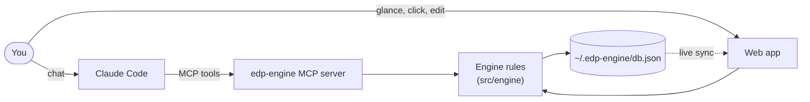
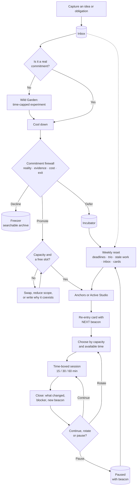
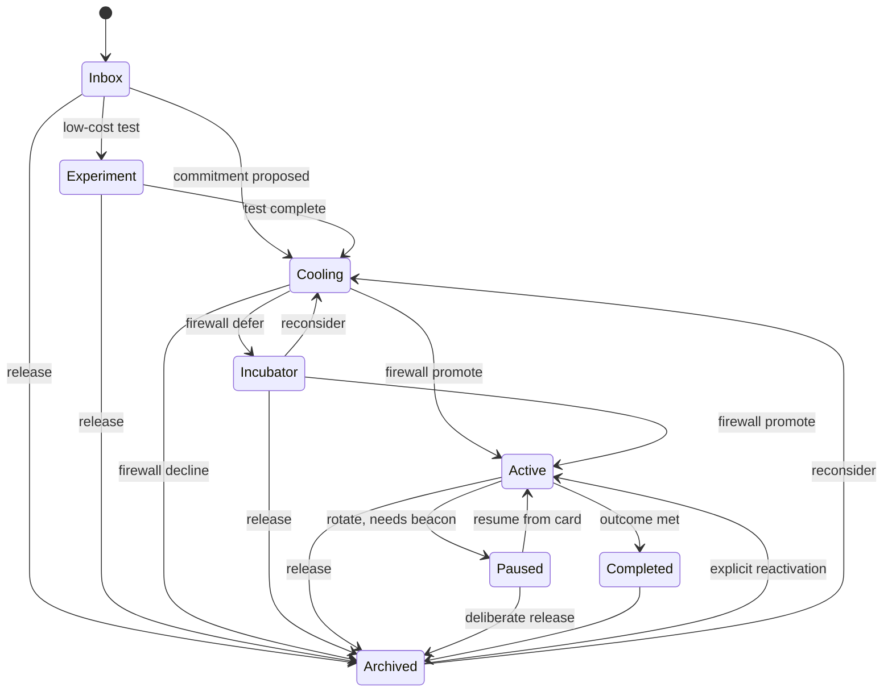

# EDP Engine

**A personal operating system for creative continuity.** It helps a person with many ideas and shifting attention *start* work, *return* to it after interruptions, and *finish* it, without killing their curiosity.

> **In one line:** capture freely, commit deliberately, and always know your next physical step.

Built from the [EDP Engine FigJam board](https://www.figma.com/board/hynjgm2OQcxF78UYiwstNt/EDP-Engine). Everything on the board is implemented.

## What it is

### The problem

The board names a friction pattern: *many attractive options → choosing feels expensive → planning expands → starting is delayed → context decays.* Ideas feel urgent because they are vivid and immediately rewarding, and interrupted work is costly to restart.

### The idea

The engine does not fight curiosity. It **constrains commitments, not ideas**, and keeps your memory outside your head. Five mechanisms carry that:

1. **Capture without commitment.** Every idea lands in one Inbox instantly. Capturing promises nothing, so a new idea can't hijack the day.
2. **A firewall before anything becomes real work.** Four gates: *what does it take time from, what evidence says it's worth it, what does it cost, when would you stop.* Then promote, defer or decline. Small things run as cheap, time-capped experiments first.
3. **A small active set.** Obligations with deadlines are **Anchors**. Creative work gets at most three **Active Studio** slots. Everything else waits in the **Wild Garden**, the **Incubator** or the **Freezer**. The limit is a default, not a law: swap one out or write why the new one coexists.
4. **Re-entry over planning.** Every active or paused project carries a re-entry card built around one beacon: **NEXT: verb + object + location + done-when.** Returning means reading one card and starting within about a minute. You can't pause without leaving a beacon.
5. **Choose by capacity, not willpower.** Say low, medium or high energy and how much time you have. Urgent deadlines come first, then work that fits. Still stuck? It picks for you.

Around that core:

- **Rituals:** a 3-minute daily open (one meaningful output), a 2-minute session close, a 15-minute weekly reset.
- **Guardrails** for the risks on the board: preparation is capped (productivity theatre), deep work starts with a basic-needs check (hyperfocus), misses are recorded by cause, not character (self-blame), and the incubator gets a weekly glance with no forced verdict (permanent incubation).
- **Measurement:** a Week-0 baseline and a two-week pilot tracking re-entry speed, outputs, missed commitments and the engine's own overhead. Every optional mechanism can be trialled or switched off: keep only what measurably helps.
- **The brain:** a graph where every project and every piece of context (decisions, insights, people, references) is a node, linked with a stated reason. Over time it becomes a memory of how your work connects.
- **Projects:** you choose the folder that holds your projects; each one becomes a parent node with everything planned for it, and any agent can ask the engine where a project lives before reading its files.
- **Boards:** when a note or project needs more room (a long plan, a breakdown, a diagram), it gets an optional handwritten canvas, like FigJam.

### How you use it

Mostly by **talking to Claude**. Through MCP, Claude runs the engine for you: capturing ideas you mention in passing, asking the firewall questions, starting and closing sessions, leaving beacons, and storing and linking context in the brain. The web app is the visual side, for glancing at today, the studio and the graph. It stays in sync with the chat. Everything runs locally.



### What it isn't

Not a clinical treatment and not a generic to-do app. It is a testable design hypothesis, built around how one person loses and regains momentum, which the pilot exists to prove or adjust.

## The workflow

From capture to a finished session, and the weekly loop that keeps it honest:



## Project states

Every move needs a reason (new evidence, changed capacity, a deadline, a completed outcome, or an explicit release). These are the only transitions the engine allows (`EDGES` in `src/engine/engine.ts`):



## Run

```sh
npm install
npm run dev      # http://localhost:5173
npm test         # engine rules + MCP end-to-end tests
npm run mcp      # run the MCP server on stdio (Claude Code starts it for you)
npm run build    # static build in dist/
```

## Demo

```sh
npm run demo     # http://localhost:5180 — resets ~/.edp-engine/demo.json each time
```

A two-week story played through the real engine rules (`server/demo.ts`), so it can't contain a state the engine forbids. Your real database is never touched; the seeder refuses to write over it. A banner marks demo mode. Walk it in this order to see the flow:

1. **Metrics → Baseline**: Week 0 guesses (25 min restart, ~2 outputs/week), then re-entry rising 71% → 89% → 100% and ~6 outputs/week.
2. **Freezer**: *NFT drop* declined at the firewall (no evidence, eats EP evenings); *Mixtape cover* completed two days early.
3. **Studio → Wild Garden**: *Synth EP* started as a 60-minute experiment before earning a studio slot; *Pixel-art tool* and *Podcast with Lebo* were deferred to the incubator because the trio was full; *Buy studio monitors* is cooling until the tax refund; *Short teaser clips* is a live 30-minute experiment.
4. **Studio → Paused**: *Portfolio refresh* paused with a full beacon while waiting on Thandi's photo permission.
5. **Today**: the tax return is due in 2 days, so it is today's one output and sits under *Protect first*.
6. **Graph**: the *Synth EP* group links the evenings decision, the resampling insight, the hyperfocus overrun note, the monitors (which depend on the tax refund) and the podcast that conflicts with EP evenings; *Pixel-art tool* forms its own small group.
7. Open any project for its firewall answers, session history and connections.

Data lives in `~/.edp-engine/db.json` (override with `EDP_DB=/path/db.json`), shared by the web app and the MCP server. Every write bumps a revision; the browser syncs live over server-sent events and re-applies its edit if Claude wrote in between. The previous state is copied to `~/.edp-engine/backups/YYYY-MM-DD.json` once a day. Anything saved by older versions in the browser is migrated on first load.

## Controlling it from Claude (MCP)

`server/mcp.ts` is an MCP server over stdio exposing the engine as tools, with usage instructions so Claude operates it on your behalf while you chat. It works whether or not the web app is running.

- In this folder it's registered by `.mcp.json` (Claude Code asks you to approve it once).
- To use it from any folder: `claude mcp add --scope user edp-engine -- "$PWD/node_modules/.bin/tsx" "$PWD/server/mcp.ts"`

| Tool | Purpose |
| --- | --- |
| `edp_overview` | Running session, today, deadlines, trio, paused, garden, inbox, failure signals |
| `edp_list_projects`, `edp_get_project` | Search and full detail (card, firewall, sessions, history) |
| `edp_capture` | Capture one or many ideas into the Inbox |
| `edp_update_project` | Edit fields and the re-entry card (partial next action, files) |
| `edp_move` | State machine transitions with reasons |
| `edp_firewall` | Four gates → promote / defer / decline |
| `edp_route` | Attention router by capacity, optional randomizer |
| `edp_start_session`, `edp_rate_reentry`, `edp_close_session` | Time-boxed sessions and the beacon on close |
| `edp_pit_stop` | Capped preparation |
| `edp_daily_open`, `edp_review_queue`, `edp_save_weekly_reset` | Rituals |
| `edp_metrics`, `edp_configure` | Measurement, baseline, pilot, mechanisms, limits |
| `edp_note` | Create / update / delete a note (context, insight, decision, reference, person, theme), optionally linking it |
| `edp_link`, `edp_unlink` | Link two nodes with a relation and a one-sentence why, or remove the link |
| `edp_graph_search` | Shortlist related nodes before creating or linking |
| `edp_graph_node`, `edp_graph_overview` | Recall a node with all its links and whys; see the groups and unlinked nodes |
| `edp_board` | Read a node's board, or add headings, handwritten text, stickies and Mermaid diagrams to it (drawn when the board is next open) |
| `edp_workspace` | Get or set the workspace root (the folder holding your projects) and list its project folders with their linked engine projects |
| `edp_project_context` | Where a project lives and what's planned for it: folder path, README, top-level files, recently changed files, git, plus state, beacon, notes and board |

Projects can be referenced by id, id prefix, or a unique part of the title. Engine rule violations come back as tool errors explaining what's missing.

## How it maps to the board

| Board | In the app |
| --- | --- |
| Inbox / single capture | Capture bar on every screen (`/` to focus) |
| Layers A/B/C | **Studio**: Anchors, Active Studio (trio limit), Wild Garden |
| State machine + transition rule | `EDGES` in `src/engine/engine.ts`; every move asks for a reason |
| Re-entry card + pause beacon | Project detail; pausing is blocked until outcome, current state and NEXT are filled |
| Commitment firewall | Four gates → Promote / Defer / Decline; cool-down warning; trio swap or explicit coexistence |
| Attention router | **Today**: capacity + 15/30/60 time box, urgent anchors first, randomizer, recovery mode |
| Session close | Stop → output, blocker, next action, file → continue / rotate / pause |
| Daily open / weekly reset | **Today** header, **Weekly reset** stepper |
| Metrics 1–4 + failure signals | **Metrics** table; failure signals surface on **Today** |
| Baseline (week 0) + two-week pilot | **Metrics → Baseline & pilot**; pilot week focus shown on **Today** |
| Playground | **Today**: shortcuts to active work and its files (URLs open, paths copy) |
| Low-dopamine pit stop | **Today**: capped preparation timer (≤30 min); counted as "Prep", not output |
| Body doubling | Session toggle; re-entry success compared with vs without |
| External cues | Optional stopping-cue notification; deadlines export to calendar (.ics) |
| Risk guardrails | Hyperfocus check before high-capacity work and on long overruns; misses logged by cause (scope / cues / capacity / friction); productivity-theatre signal when prep > work; incubator glanced weekly without forcing a verdict |
| Experiment plan + iteration rule | **Metrics → Mechanisms**: on / trial / off with notes; warns if more than one trial at once |
| Evidence limits + sources | **Metrics → Evidence & limits** |
| The brain (graph) | **Graph**: every project and note is a node; links carry a relation and a reason; groups emerge from connectivity and are named after their most-connected node. Notes never become tasks. |
| Projects (local folders) | **Projects**: choose the folder that holds your projects (e.g. `~/Documents`). Every subfolder is listed with its README summary, recent activity, engine state, beacon, notes and board; **Track** captures it into the Inbox linked to its folder. Folder-linked projects are parent nodes in the graph. The engine only reads names, dates, READMEs and git metadata, skips hidden files such as `.env`, and never writes into project folders; agents use `edp_project_context` to find a project, then read its files themselves. |
| Boards (detailed notes) | **Open board** on any project or note: a FigJam-style handwritten canvas ([Excalidraw](https://github.com/excalidraw/excalidraw), MIT) for long plans and diagrams. One file per board in `~/.edp-engine/boards/`; edits from you and Claude merge by element version and appear live. Fonts are served locally, so boards work offline. |

All rules live as pure functions in `src/engine/` so they can be tested and changed without touching the UI.
